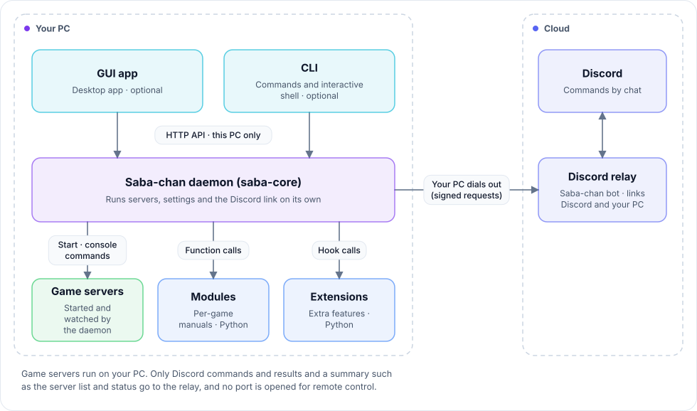
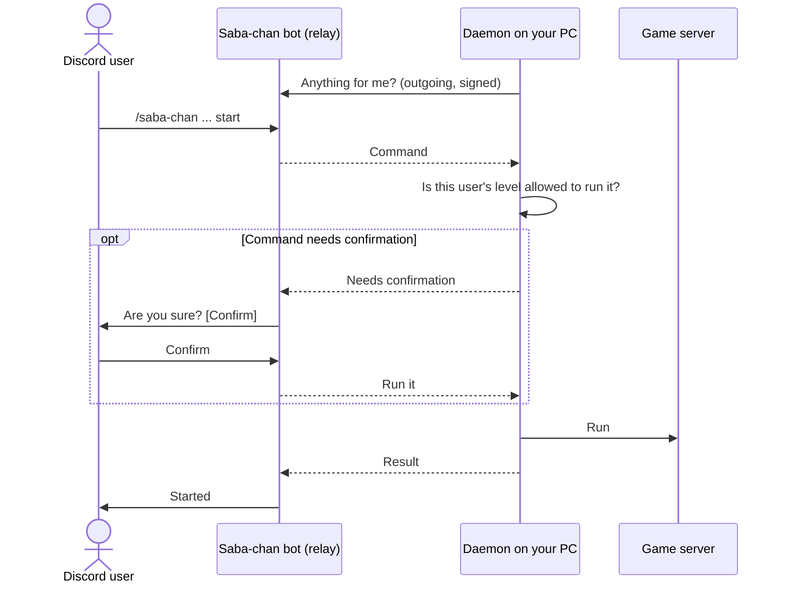

<div align="center">

<picture>
  <source media="(prefers-color-scheme: dark)" srcset="docs/images/banner-dark.png">
  
</picture>

A server manager that starts, watches over, and fixes your game servers for you

[한국어](README.md) · **English** · [日本語](README.ja.md)

[Website](https://saba-chan.online) · [Guide](https://saba-chan.online/guide) · [Modules](https://github.com/WareAoba/saba-chan-modules) · [Extensions](https://github.com/WareAoba/saba-chan-extensions) · [Releases](https://github.com/WareAoba/saba-chan/releases)

[](LICENSE)


</div>

If you've ever hosted a Minecraft or Palworld server for friends, you know the drill. Download the server files, write a batch file, dig through config files, and when the server dies at 2 a.m. everyone waits until someone wakes up to restart it. Switch games and you get to learn it all over again.

Saba-chan does that work for you. Pick a game and it handles install, launch, settings, and backups from one app, and your friends can start or stop the server from Discord chat. Everything game-specific lives in a "module", a kind of instruction manual, so Saba-chan itself treats every game the same way.

The name is a pun: in Japanese, "server" (サーバー) sounds a lot like "mackerel" (鯖, saba).

## What it does

**Running servers**

- Create, start, and stop multiple game servers and watch their consoles from one screen. You can run several servers of the same game; each new one gets its own folder and a port that doesn't clash.
- New servers are set up step by step: game, server type and version, install location, how it runs, then name and port. If the name or port collides with another server, you hear about it before anything is created.
- Edit game settings field by field in the app instead of opening config files.
- Servers that crash get restarted. Servers you stopped on purpose are left alone, and every stop is logged with the reason.
- Each server has a small watcher process (`saba-runner`), so the server keeps running and the console picks up where it left off even if you restart Saba-chan.
- World backups and restores, plus scheduled jobs like nightly restarts or backups.

**From Discord**

- Invite the Saba-chan bot to your Discord server and link it to your PC, then start, stop, and check servers with chat or `/saba-chan` commands. You don't need to open router ports for remote control, because your PC makes the outgoing connection.
- Each Discord server has its own ladder of levels (owner, admin, user, guest, banned), and you choose which commands each level can use. Higher levels can always do everything the levels below them can.
- Risky commands such as stop or restart ask for confirmation first. How often it asks is set per Discord server.
- The bot also plays music and has "Talking Saba-chan", an AI chat feature. Talking Saba-chan runs on an AI API key you provide and has to be turned on per Discord server.

**When you're away**

- Phone: get a one-time link with `/saba-chan web` in Discord and manage servers, console, and settings from your phone's browser. Nothing to install, no login.
- Another PC: control Saba-chan running on a Linux box or another PC from your own app and CLI (remote daemon). Only PCs paired with the same Discord account can connect.
- AI agents: link an MCP-capable agent such as Claude to your Discord account and it can manage your servers. Dangerous commands are confirmed in the agent's own screen first. Check or unlink the agent with `/saba-chan agent` or from the Discord screen in the app.

**And also**

- Anything the app does, the CLI does too (`saba-chan-cli start pal`). See [saba-chan-cli/README.md](saba-chan-cli/README.md).
- Notifications for who started or stopped which server and from where, including unexpected starts and stops, in the app, as OS notifications, and in a Discord alert channel.
- 10 languages: 한국어, English, 日本語, Deutsch, Español, Français, Português, Русский, 简体中文, 繁體中文.

## Supported games

| Game | Install | Windows | Linux x64 | Linux ARM64 |
|---|---|:-:|:-:|:-:|
| Minecraft (Java) | Official server files | Yes | Yes | Testing |
| Palworld | SteamCMD | Yes | Yes | No |
| Project Zomboid | SteamCMD | Yes | Yes | No |
| Terraria | Official server files | Yes | Yes | No |

The games marked "No" on ARM only ship x86 server binaries, or need SteamCMD, which is x86 only. Saba-chan doesn't emulate; it simply won't offer those games on ARM. You can add other games by writing a module in the [modules repo](https://github.com/WareAoba/saba-chan-modules).

## Install

| | App (GUI) | CLI | Daemon only (headless) |
|---|:-:|:-:|:-:|
| Windows 10/11 x64 | Yes | Yes | Yes |
| Linux x64 | Yes | Yes | Yes |
| Linux ARM64 | - | Yes | Yes |
| macOS | Planned | Planned | - |

The Linux desktop app and ARM64 builds arrive in 0.1.12. For macOS, the first step is an app that controls Saba-chan running on another machine.

**Windows**

Download `saba-chan-installer.exe` from the [website](https://saba-chan.online) or [Releases](https://github.com/WareAoba/saba-chan/releases), run it, and pick an install location and the games you want. It needs the WebView2 runtime, which Windows 11 and up-to-date Windows 10 already have.

**Linux**

```sh
curl -fsSL https://raw.githubusercontent.com/WareAoba/saba-chan/main/install.sh | sh
```

You need `curl`, `unzip`, `sha256sum`, and `python3`. On a desktop with a display it installs the app too and adds it to your app menu. On a headless server it installs just the daemon and CLI and runs the daemon as a systemd user service. The app needs WebKitGTK; if it's missing, the script tells you the package to install. A headless server is easiest to manage from the app on another PC as a [remote daemon](https://saba-chan.online/guide/remote-daemon).

**After installing**

- Settings, server files, worlds, and backups live in `%APPDATA%\saba-chan` (`~/.config/saba-chan` on Linux). Deleting the program folder leaves your servers alone.
- The app tells you when an update is out and installs it from the settings screen. Only officially signed files are accepted.
- When uninstalling, tick "Keep game servers" and "Keep settings" and a reinstall picks up right where you left off. You can choose each one separately.

## How it fits together

All the work happens in one daemon (`saba-core`). The app and CLI are remote controls that ask the daemon to do things, so on an always-on server you can run the daemon alone.

<p align="center">
  <picture>
    <source media="(prefers-color-scheme: dark)" srcset="docs/images/architecture-en-dark.svg">
    
  </picture>
</p>

Here's what happens when someone sends a command from Discord. The relay never reaches into your PC; the daemon keeps asking the relay whether anything new has come in.



| Component | Where | What it does |
|---|---|---|
| Daemon `saba-core` | `src/` (Rust) | Everything: running servers, settings, the Discord connection |
| App | `saba-chan-gui/` (Tauri + React) | Desktop app that drives the daemon |
| CLI | `saba-chan-cli/` (Rust) | Command-line tool and interactive shell |
| Web remote | `saba-chan-web/` | Screens for a phone browser |
| Runner `saba-runner` | `runner/` (Rust) | Watcher process attached to each server |
| Updater, installer | `updater/`, `installer/` | Installs and updates from signed releases |
| Modules | [saba-chan-modules](https://github.com/WareAoba/saba-chan-modules) | Per-game manuals (`module.toml` + `lifecycle.py`) |
| Extensions | [saba-chan-extensions](https://github.com/WareAoba/saba-chan-extensions) | Add-ons like SteamCMD or Unreal config editing (Python) |

The deeper material is in [docs/architecture/](docs/architecture/00-overview.md) (Korean). It's written from the code, with a file and line reference behind each claim, and it changes in the same commit whenever a contract such as the API or `module.toml` changes.

## Security

- The daemon only listens inside your PC (`127.0.0.1`) and checks an access token on every request. A TLS port opens only if you turn on the remote daemon yourself, and only PCs paired with the same Discord account get in.
- Commands exchanged with the relay are signed with a key issued when you link the PC.
- App, module, and extension updates come only from releases with a valid official signature, and every downloaded file is checked against its hash.
- Modules and extensions without an official signature run isolated (AppContainer on Windows, bubblewrap on Linux). Where isolation isn't available, they only run if you agree to it.
- Friends still need the game's own port open to join. The only port Saba-chan makes unnecessary is one for remote control.

## Building from source

```powershell
# Full Windows build (unsigned)
.\scripts\build-windows.ps1

# Just the daemon and CLI
cargo build --release
cargo build --release -p saba-chan-cli

# App in dev mode
cd saba-chan-gui; npm install; npm start
```

Release files are built from this repository by GitHub Actions: [build-windows.yml](.github/workflows/build-windows.yml) for Windows and [release.yml](.github/workflows/release.yml) for Linux x64 and ARM64. Run tests with `cargo test --workspace` and `cd saba-chan-gui && npx vitest run`.

## Code signing policy

Free code signing provided by [SignPath.io](https://signpath.io), certificate by [SignPath Foundation](https://signpath.org).

- What gets signed: only the Windows executables that GitHub Actions builds from this repository's source (`saba-core.exe`, `saba-runner.exe`, `saba-chan-cli.exe`, `saba-chan-gui.exe`, `saba-chan-updater.exe`, `saba-chan-installer.exe`). The build is public in [build-windows.yml](.github/workflows/build-windows.yml).
- Committers and reviewers: [WareAoba](https://github.com/WareAoba)
- Approvers: [WareAoba](https://github.com/WareAoba), who approves the signing request for every release.
- Privacy policy: Saba-chan sends data only for update checks (on by default, can be turned off; an anonymous ID and version numbers) and for the Discord integration the user connects. Details are in the [privacy policy](https://saba-chan.online/legal/privacy).

## License

[MIT](LICENSE)
