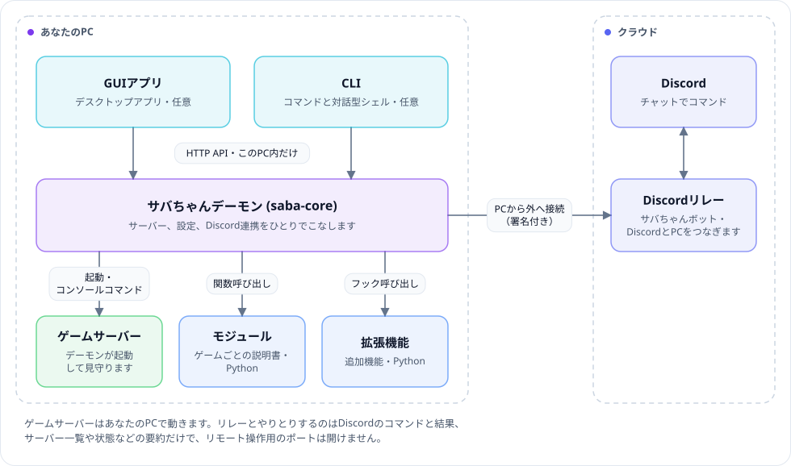
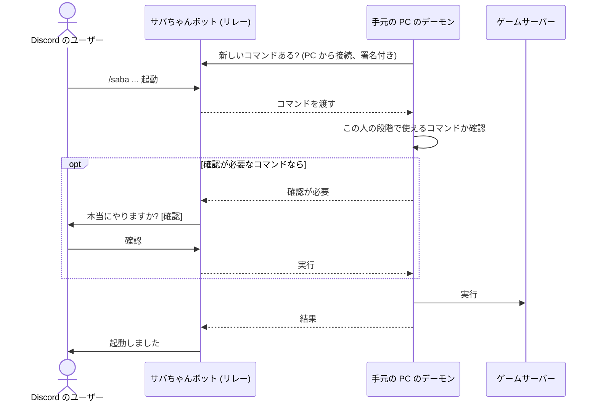

<div align="center">

<picture>
  <source media="(prefers-color-scheme: dark)" srcset="docs/images/banner-dark.png">
  
</picture>

ゲームサーバーの起動も見守りも復旧も代わりにやってくれる、サーバー管理アプリ

[한국어](README.md) · [English](README.en.md) · **日本語**

[ウェブサイト](https://saba-chan.online/ja) · [使い方](https://saba-chan.online/ja/guide) · [モジュール](https://github.com/WareAoba/saba-chan-modules) · [拡張機能](https://github.com/WareAoba/saba-chan-extensions) · [リリース](https://github.com/WareAoba/saba-chan/releases)

[](LICENSE)


</div>

友だちとマイクラやパルワールドのサーバーを立てたことがあるなら、たぶん覚えがあると思います。サーバーファイルを落として、バッチファイルを書いて、設定ファイルを探し回って、夜中にサーバーが落ちたら誰かが起きて立て直すまでみんな待つ。ゲームが変わればまた一から覚え直しです。

サバちゃんはその手間を引き受けます。ゲームを選べば、インストールから起動、設定、バックアップまでひとつのアプリで済み、友だちも Discord のチャットからサーバーを起動・停止できます。ゲームごとの違いは「モジュール」という説明書に入っているので、サバちゃん自体はどのゲームも同じやり方で扱います。

名前は、サーバーと鯖(さば)の響きが似ているところから来ています。

## できること

**サーバー管理**

- 複数のゲームサーバーをひとつの画面で作成・起動・停止し、コンソールを見られます。同じゲームのサーバーを何台でも置けて、新しいサーバーには重ならないポートと専用フォルダが割り当てられます。
- 新しいサーバーは順番に選ぶだけで作れます。ゲーム、サーバーの種類とバージョン、インストール先、起動方法、名前とポート。名前やポートがほかのサーバーと重なっていれば、作る前に教えてくれます。
- ゲームの設定はファイルを開かずに、アプリで項目ごとに変えられます。
- エラーで落ちたサーバーだけを選んで再起動します。自分で止めたサーバーには手を出さず、なぜ止まったかを記録に残します。
- サーバーごとに小さな見張りプロセス(`saba-runner`)が付くので、サバちゃんを再起動してもサーバーは動き続け、コンソールもそのまま続きます。
- ワールドのバックアップと復元、定期再起動やバックアップなどの予約タスクもあります。

**Discord から**

- サバちゃんボットを Discord サーバーに招待して PC とつなげば、チャットや `/saba` コマンド(韓国語の Discord では `/사바쨩`)でサーバーの起動・停止・状態確認ができます。PC のほうから外へ接続する仕組みなので、遠隔操作のためにルーターのポートを開ける必要はありません。
- Discord サーバーごとにオーナー・管理者・ユーザー・ゲスト・禁止の段階があり、段階ごとに使えるコマンドを決められます。上の段階は、下の段階ができることを必ず全部できます。
- 危険なコマンドは、実行前にボタンでもう一度確認します。初期設定では危険段階のコマンドだけを確認し、Discord サーバーごとに停止や再起動のような注意段階、あるいは全コマンドまで広げられます。
- ボットには音楽再生と、AI と話せる「おしゃべりサバちゃん」もあります。おしゃべりサバちゃんは自分で登録した AI の API キーで動き、Discord サーバーごとにオンにする必要があります。

**外出先から**

- スマホ: Discord の `/saba web` で受け取ったリンク(その PC の持ち主だけが受け取れて、5 分以内に 1 回だけ使えます)から、ブラウザでサーバーの起動・停止やコンソール、設定を扱えます。インストールもログインもいりません。
- 別の PC: Linux サーバーや別の PC で動くサバちゃんを、手元のアプリと CLI でそのまま操作できます(リモートデーモン)。同じ Discord アカウントでペアにした PC 同士だけがつながります。
- AI エージェント: Claude など MCP に対応したエージェントを自分の Discord アカウントに連携すると、エージェントがサーバーを操作できます。危ないコマンドはエージェントの画面で先に確認します。連携は `/saba agent` やアプリの Discord 画面で確認・解除できます。

**そのほか**

- アプリでできることは CLI でも全部できます(`saba-chan-cli start pal`)。詳しくは [saba-chan-cli/README.md](saba-chan-cli/README.md)(韓国語)へ。
- 誰がどこからサーバーを起動・停止したか、予期しない起動や停止まで、アプリ・OS の通知・Discord の通知チャンネルで知らせます。
- 한국어、English、日本語、Deutsch、Español、Français、Português、Русский、简体中文、繁體中文の 10 言語に対応しています。

## 対応ゲーム

| ゲーム | インストール | Windows | Linux x64 | Linux ARM64 |
|---|---|:-:|:-:|:-:|
| Minecraft (Java) | 公式サーバーファイル | ○ | ○ | 確認中 |
| Palworld | SteamCMD | ○ | ○ | × |
| Project Zomboid | SteamCMD | ○ | ○ | × |
| Terraria | 公式サーバーファイル | ○ | ○ | × |

ARM で × のゲームは、サーバーの実行ファイルや SteamCMD が x86 用しかないためです。エミュレーションはせず、動かないゲームはサーバー作成画面で最初から選べないようにしています。ほかのゲームは[モジュールのリポジトリ](https://github.com/WareAoba/saba-chan-modules)で自分で作れます。

## インストール

| | アプリ (GUI) | CLI | デーモンのみ (画面なしサーバー) |
|---|:-:|:-:|:-:|
| Windows 10/11 x64 | ○ | ○ | ○ |
| Linux x64 | ○ | ○ | ○ |
| Linux ARM64 | - | ○ | ○ |
| macOS | 準備中 | 準備中 | - |

Linux のデスクトップアプリと ARM64 は 0.1.12 からです。macOS は、別の PC のサバちゃんを操作するアプリから準備しています。

**Windows**

[ウェブサイト](https://saba-chan.online/ja)か[リリース](https://github.com/WareAoba/saba-chan/releases)から `saba-chan-installer.exe` を落として実行し、インストール先と最初に入れるゲームを選ぶだけです。WebView2 ランタイムが必要ですが、Windows 11 と最新の Windows 10 には最初から入っています。

**Linux**

```sh
curl -fsSL https://raw.githubusercontent.com/WareAoba/saba-chan/main/install.sh | sh
```

`curl`、`unzip`、`sha256sum`、`python3` があれば大丈夫です。画面のあるデスクトップならアプリまで入れてアプリメニューに追加し、画面のないサーバーならデーモンと CLI だけを入れてデーモンを systemd のユーザーサービスとして起動します。アプリには WebKitGTK が、SteamCMD で入れるゲーム(パルワールド、Zomboid)には `lib32gcc-s1` などの 32 ビットライブラリが必要で、入っていなければインストールコマンドを教えてくれます。画面のないサーバーは、別の PC のアプリから[リモートデーモン](https://saba-chan.online/ja/guide/remote-daemon)として操作するのが楽です。

**インストールしたあと**

- 設定と、場所を別に選ばなかったサーバーファイル、ワールド、バックアップは `%APPDATA%\saba-chan`(Linux は `~/.config/saba-chan`)にあります。プログラムのフォルダを消してもサーバーは残ります。
- 新しいバージョンが出るとアプリが知らせてくれて、設定画面からそのまま更新できます。公式の署名が確認できたファイルだけを受け取ります。
- アンインストールのときに「ゲームサーバーを残す」と「設定を残す」を選べば、入れ直したときにそのまま続きから使えます。どちらか片方だけも選べます。

## しくみ

仕事はすべてデーモン(`saba-core`)ひとつがこなします。アプリと CLI はデーモンにお願いするリモコンなので、常時起動のサーバー PC ならデーモンだけ動かしておけば十分です。

<p align="center">
  <picture>
    <source media="(prefers-color-scheme: dark)" srcset="docs/images/architecture-ja-dark.svg">
    
  </picture>
</p>

Discord からコマンドを送ると、こう流れます。リレーが PC に話しかけるのではなく、PC のデーモンがリレーに新しいコマンドがないかを聞き続けています。



| 構成要素 | 場所 | 役割 |
|---|---|---|
| デーモン `saba-core` | `src/` (Rust) | サーバーの実行、設定、Discord との接続まで、すべての機能 |
| アプリ | `saba-chan-gui/` (Tauri + React) | デーモンを操作するデスクトップアプリ |
| CLI | `saba-chan-cli/` (Rust) | コマンドラインツールと対話シェル |
| ウェブリモート | `saba-chan-web/` | スマホのブラウザ向け画面 |
| ランナー `saba-runner` | `runner/` (Rust) | サーバーごとに付く見張りプロセス |
| アップデーター、インストーラー | `updater/`, `installer/` | 署名付きリリースからのインストールと更新 |
| モジュール | [saba-chan-modules](https://github.com/WareAoba/saba-chan-modules) | ゲームごとの説明書 (`module.toml` + `lifecycle.py`) |
| 拡張機能 | [saba-chan-extensions](https://github.com/WareAoba/saba-chan-extensions) | SteamCMD や Unreal の設定ファイル編集などの追加機能 (Python) |

詳しい中身は [docs/architecture/](docs/architecture/00-overview.md)(韓国語)にあります。コードを読んで書いた文書で、根拠ごとにファイルと行番号が付いていて、API や `module.toml` などの約束ごとが変わると同じコミットで直します。

## セキュリティ

- デーモンはこの PC の中(`127.0.0.1`)でしかリクエストを受けず、リクエストごとにアクセストークンを確認します。リモートデーモンを自分でオンにしたときだけ TLS のポートが開き、同じ Discord アカウントでペアにした PC だけが入れます。
- リレーとやり取りするコマンドは、接続時に受け取った鍵で署名します。
- アプリ・モジュール・拡張機能の更新は、公式の署名が確認できたリリースからだけ受け取り、落としたファイルはひとつずつハッシュで確かめます。
- 公式の署名がないモジュールや拡張機能は隔離して動かします(Windows は AppContainer、Linux は bubblewrap)。隔離できない環境では、自分で同意したときだけ動きます。
- 友だちがゲームに入るには、ゲームのポートはいつもどおり開けておく必要があります。サバちゃんがいらなくしてくれるのは遠隔操作用のポートだけです。

## ソースからビルド

```powershell
# Windows の全体ビルド (署名なし)
.\scripts\build-windows.ps1

# デーモンと CLI だけ
cargo build --release
cargo build --release -p saba-chan-cli

# アプリの開発モード
cd saba-chan-gui; npm install; npm start
```

配布ファイルは GitHub Actions がこのリポジトリのソースからビルドします。Windows は [build-windows.yml](.github/workflows/build-windows.yml)、Linux x64・ARM64 は [release.yml](.github/workflows/release.yml) です。テストは `cargo test --workspace` と `cd saba-chan-gui && npx vitest run` で回します。

## コード署名ポリシー · Code signing policy

Free code signing provided by [SignPath.io](https://signpath.io), certificate by [SignPath Foundation](https://signpath.org).

- 署名するファイル: このリポジトリのソースから GitHub Actions がビルドした Windows の実行ファイル(`saba-core.exe`、`saba-runner.exe`、`saba-chan-cli.exe`、`saba-chan-gui.exe`、`saba-chan-updater.exe`、`saba-chan-installer.exe`)だけに署名します。ビルドの流れは [build-windows.yml](.github/workflows/build-windows.yml) で公開しています。
- Committers and reviewers: [WareAoba](https://github.com/WareAoba)
- Approvers: [WareAoba](https://github.com/WareAoba)。リリースごとに署名リクエストを自分で承認します。
- プライバシー · Privacy policy: サバちゃんがほかの場所へ情報を送るのは、更新の確認(初期設定でオン、オフにできます。匿名 ID、バージョン、プラットフォーム、更新チャンネルだけを送ります)と、ユーザーが自分でつないだ Discord 連携だけです。詳しくは[プライバシーポリシー](https://saba-chan.online/ja/legal/privacy)をご覧ください。

## ライセンス

[MIT](LICENSE)
