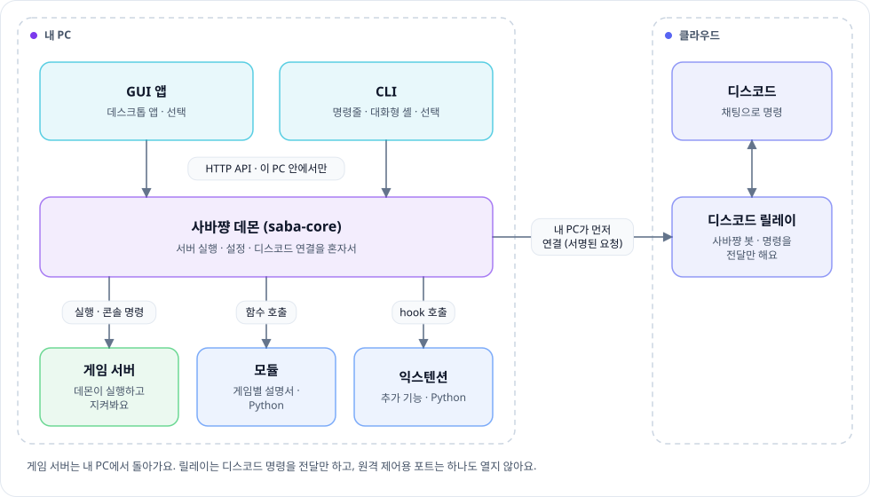
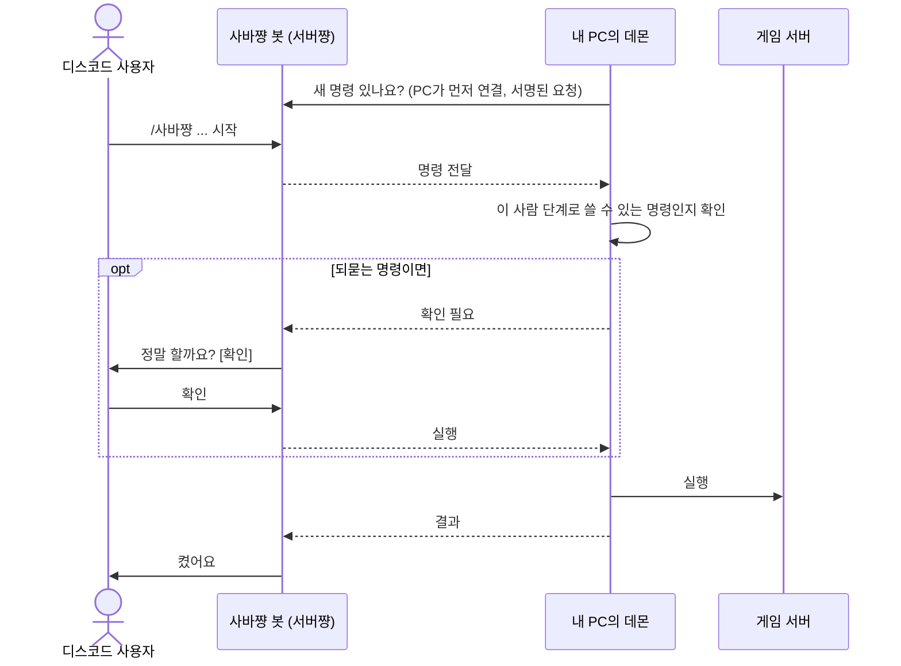

<div align="center">

<picture>
  <source media="(prefers-color-scheme: dark)" srcset="docs/images/banner-ko-dark.png">
  
</picture>

게임 서버를 대신 켜고, 지키고, 고쳐 주는 서버 관리 앱

**한국어** · [English](README.en.md) · [日本語](README.ja.md)

[웹사이트](https://saba-chan.online/ko) · [사용 안내](https://saba-chan.online/ko/guide) · [모듈](https://github.com/WareAoba/saba-chan-modules) · [익스텐션](https://github.com/WareAoba/saba-chan-extensions) · [릴리스](https://github.com/WareAoba/saba-chan/releases)

[](LICENSE)


</div>

친구들이랑 마인크래프트나 팰월드 서버를 열어 본 적이 있다면 알 거예요. 서버 파일 받고, 배치 파일 만들고, 설정 파일 뒤지고, 밤에 서버가 죽으면 누가 다시 켜 줄 때까지 다들 기다리고. 게임이 바뀌면 그걸 처음부터 다시 배워야 하고요.

사바쨩은 그 일을 대신 합니다. 게임을 고르면 설치부터 실행, 설정, 백업까지 앱 하나에서 하고, 디스코드 채팅으로 친구들도 서버를 켜고 끌 수 있어요. 게임마다 다른 부분은 "모듈"이라는 설명서에 들어 있어서, 사바쨩 자체는 어떤 게임이든 같은 방식으로 다룹니다.

이름은 일본어로 서버(サーバー)와 고등어(鯖, さば) 발음이 비슷한 데서 왔어요.

## 할 수 있는 것

**서버 관리**

- 여러 게임 서버를 한 화면에서 만들고, 켜고, 끄고, 콘솔을 봅니다. 같은 게임 서버도 여러 개 둘 수 있고, 새 서버는 겹치지 않는 포트와 자기 폴더를 받아요.
- 새 서버는 단계별로 만듭니다. 게임, 서버 종류와 버전, 설치 위치, 실행 방식, 이름과 포트를 고르면 끝이고, 이름이나 포트가 다른 서버와 겹치면 만들기 전에 알려 줘요.
- 게임 설정은 파일을 열지 않고 앱에서 항목별로 고칩니다.
- 오류로 꺼진 서버만 골라서 다시 켭니다. 일부러 끈 서버는 건드리지 않고, 왜 꺼졌는지 기록을 남겨요.
- 서버마다 작은 감시 프로세스(`saba-runner`)가 붙어 있어서 사바쨩을 껐다 켜도 서버는 계속 돌고 콘솔도 이어집니다.
- 월드 백업과 복원, 정기 재시작이나 백업 같은 예약 작업도 됩니다.

**디스코드에서**

- 사바쨩 봇을 디스코드 서버에 초대하고 PC와 연결하면, 채팅이나 `/사바쨩` 명령으로 서버를 켜고 끄고 상태를 봅니다. 원격 제어를 위해 공유기 포트를 열 필요는 없어요. PC가 먼저 바깥으로 연결하는 방식이라서요.
- 디스코드 서버마다 소유자, 관리자, 유저, 게스트, 금지 단계를 두고, 단계마다 쓸 수 있는 명령을 정합니다. 위쪽 단계는 아래 단계가 할 수 있는 건 다 할 수 있어요.
- 위험한 명령은 실행하기 전에 버튼으로 한 번 더 묻습니다. 기본은 위험 단계 명령만 묻고, 디스코드 서버마다 정지·재시작 같은 주의 단계나 모든 명령까지 묻게 넓힐 수 있어요.
- 봇에는 "노래하는 사바쨩"(음악 재생), "말하는 사바쨩"(AI 대화), "읽어주는 사바쨩"(내 채팅을 음성 채널에서 읽기)도 있어요. 말하는 사바쨩은 직접 넣은 AI API 키로 돌고, 디스코드 서버마다 따로 켜야 합니다.
- 채팅 청소·자동 청소, 음소거, 채널 잠금·슬로우 모드 같은 디스코드 서버 관리 명령과 `/전적`(롤, 배그, 메이플, 이터널 리턴 등 게임 전적 카드)도 있어요.
- 이런 봇 기능은 PC를 연결하지 않은 디스코드 서버에서도 씁니다. 처음 쓰는 사람은 웹사이트에서 약관을 보고 한 번 등록해요.

**밖에서**

- 휴대폰: 디스코드에서 `/사바쨩 웹`으로 받은 링크(받은 사람의 디스코드 계정에 묶이고, 5분 안에 한 번 쓰는 링크)로 브라우저에서 서버를 켜고 끄고 콘솔과 설정을 봅니다. PC가 없어도 내가 관리하는 디스코드 서버의 사바쨩 설정은 바꿀 수 있어요. 설치나 로그인은 필요 없어요.
- 다른 PC: 리눅스 서버나 다른 PC에서 도는 사바쨩을 내 PC의 앱과 CLI로 그대로 다룹니다(원격 데몬). 같은 디스코드 계정으로 짝지은 PC끼리만 이어져요.
- AI 에이전트: Claude 같은 MCP 지원 에이전트를 내 디스코드 계정으로 연결하면 에이전트가 내 서버를 다룰 수 있어요. 위험한 명령은 에이전트 화면에서 먼저 묻습니다. 연결은 `/내사바쨩 에이전트`나 앱의 디스코드 화면에서 확인하고 끊을 수 있어요.

**그 밖에**

- 앱으로 하는 일은 CLI로도 다 됩니다(`saba-chan-cli start pal`). 자세한 건 [saba-chan-cli/README.md](saba-chan-cli/README.md)에 있어요.
- 누가 어디서 서버를 켜고 껐는지, 예상하지 못한 시작과 정지까지 앱, OS 알림, 디스코드 알림 채널로 알려 줍니다.
- 한국어, English, 日本語, Deutsch, Español, Français, Português, Русский, 简体中文, 繁體中文 10개 언어를 지원해요.

## 지원 게임

| 게임 | 설치 | Windows | Linux x64 | Linux ARM64 |
|---|---|:-:|:-:|:-:|
| Minecraft (Java) | 공식 서버 파일 | O | O | O |
| Palworld | SteamCMD | O | O | X |
| Project Zomboid | SteamCMD | O | O | X |
| Terraria | 공식 서버 파일 | O | O | X |

ARM에서 안 되는 게임은 서버 실행 파일이나 SteamCMD가 x86용뿐이라서 그래요. 에뮬레이션은 하지 않고, 안 되는 게임은 서버 만들기 화면에서 미리 막습니다. 다른 게임은 [모듈 저장소](https://github.com/WareAoba/saba-chan-modules)에서 직접 만들 수 있어요.

## 설치

| | 앱 (GUI) | CLI | 데몬만 (화면 없는 서버) |
|---|:-:|:-:|:-:|
| Windows 10/11 x64 | O | O | O |
| Linux x64 | O | O | O |
| Linux ARM64 | - | O | O |
| macOS | 준비 중 | 준비 중 | - |

리눅스 데스크톱 앱과 ARM64는 0.1.12부터 들어갑니다. macOS는 다른 PC의 사바쨩을 다루는 앱부터 준비하고 있어요.

**Windows**

[웹사이트](https://saba-chan.online/ko)나 [릴리스](https://github.com/WareAoba/saba-chan/releases)에서 `saba-chan-installer.exe`를 받아 실행하고, 설치 위치와 처음 받을 게임을 고르면 됩니다. WebView2 런타임이 필요한데 Windows 11과 최신 Windows 10에는 이미 들어 있어요.

**Linux**

```sh
curl -fsSL https://raw.githubusercontent.com/WareAoba/saba-chan/main/install.sh | sh
```

`curl`, `unzip`, `sha256sum`, `python3`가 있으면 됩니다. 화면이 있는 데스크톱이면 앱까지 설치해서 앱 메뉴에 넣고, 화면 없는 서버면 데몬과 CLI만 깔고 데몬을 systemd 사용자 서비스로 켜요. 앱을 쓰려면 WebKitGTK가 필요하고, SteamCMD로 까는 게임(팰월드, 좀보이드)은 32비트 라이브러리(`lib32gcc-s1` 등)가 필요해요. 없으면 설치 명령을 알려 줍니다. 화면 없는 서버는 다른 PC의 앱에서 [원격 데몬](https://saba-chan.online/ko/guide/remote-daemon)으로 다루면 편해요.

**설치한 다음**

- 설정과, 따로 고르지 않은 서버 파일, 월드, 백업은 `%APPDATA%\saba-chan`(리눅스는 `~/.config/saba-chan`)에 있어요. 프로그램 폴더를 지워도 서버는 남습니다.
- 새 버전이 나오면 앱이 알려 주고 설정 화면에서 바로 업데이트합니다. 공식 서명이 확인된 파일만 받아요.
- 지울 때 "게임 서버 남기기"와 "설정 남기기"를 고르면 다시 설치했을 때 그대로 이어집니다. 둘은 따로 고를 수 있어요.

## 구조

일은 전부 데몬(`saba-core`) 하나가 합니다. 앱과 CLI는 데몬에게 부탁하는 리모컨이라, 늘 켜 두는 서버 PC라면 데몬만 돌려도 돼요.

<p align="center">
  <picture>
    <source media="(prefers-color-scheme: dark)" srcset="docs/images/architecture-dark.svg">
    
  </picture>
</p>

디스코드에서 명령을 보내면 이렇게 흘러갑니다. 서버쨩이 PC에 먼저 말을 거는 게 아니라, PC의 데몬이 서버쨩에 새 명령이 있는지 계속 물어보는 쪽이에요.



| 구성요소 | 위치 | 하는 일 |
|---|---|---|
| 데몬 `saba-core` | `src/` (Rust) | 서버 실행, 설정, 디스코드 연결까지 모든 기능 |
| 앱 | `saba-chan-gui/` (Tauri + React) | 데몬을 다루는 데스크톱 앱 |
| CLI | `saba-chan-cli/` (Rust) | 명령줄 도구와 대화형 셸 |
| 웹 원격 | `saba-chan-web/` | 휴대폰 브라우저용 화면 |
| 러너 `saba-runner` | `runner/` (Rust) | 서버마다 붙는 감시 프로세스 |
| 인스톨러 | `installer/`, `updater/`(공용 라이브러리) | 설치, 업데이트 적용, 제거를 한 프로그램(`saba-chan-installer`)으로 |
| 모듈 | [saba-chan-modules](https://github.com/WareAoba/saba-chan-modules) | 게임별 설명서 (`module.toml` + `lifecycle.py`) |
| 익스텐션 | [saba-chan-extensions](https://github.com/WareAoba/saba-chan-extensions) | SteamCMD, 언리얼 설정 파일 편집 같은 추가 기능 (Python) |

더 깊은 내용은 [docs/architecture/](docs/architecture/00-overview.md)에 있어요. 코드를 읽고 쓴 문서라 근거마다 파일과 줄 번호가 달려 있고, API나 `module.toml` 같은 계약이 바뀌면 같은 커밋에서 같이 고칩니다.

## 보안

- 데몬은 이 PC 안(`127.0.0.1`)에서만 요청을 받고, 요청마다 접근 토큰을 확인합니다. 원격 데몬용 TLS 포트는 처음부터 열려 있고(설정에서 끌 수 있어요), 같은 디스코드 계정으로 짝지은 PC만 들어올 수 있어요.
- 서버쨩과 주고받는 명령은 연결할 때 받은 키로 서명합니다.
- 앱, 모듈, 익스텐션 업데이트는 공식 서명이 확인된 릴리스에서만 받고, 받은 파일은 하나하나 해시로 확인해요.
- 공식 서명이 없는 모듈과 익스텐션은 격리해서 돌립니다(Windows는 AppContainer, 리눅스는 bubblewrap). 격리할 수 없는 환경에서는 내가 동의해야 실행돼요.
- 친구가 게임에 들어오려면 게임 포트는 평소처럼 열어야 해요. 사바쨩이 필요 없게 해 주는 건 원격 제어용 포트뿐입니다.
- 업데이트 확인(기본으로 켜져 있고 끌 수 있어요. 익명 ID, 버전, 플랫폼, 업데이트 채널만 보냅니다)과 직접 연결한 디스코드 연동 말고는 다른 곳으로 정보를 보내지 않아요. 자세한 건 [개인정보처리방침](https://saba-chan.online/ko/legal/privacy)에 있어요.

## 소스에서 빌드

```powershell
# Windows 전체 빌드 (서명 안 함)
.\scripts\build-windows.ps1

# 데몬과 CLI만
cargo build --release
cargo build --release -p saba-chan-cli

# 앱 개발 모드
cd saba-chan-gui; npm install; npm start
```

배포 파일은 GitHub Actions가 이 저장소의 소스로 빌드합니다. Windows는 [build-windows.yml](.github/workflows/build-windows.yml), 리눅스 x64·ARM64는 [release.yml](.github/workflows/release.yml)이에요. 테스트는 `cargo test --workspace`와 `cd saba-chan-gui && npx vitest run`으로 돌립니다.

## 라이선스

[MIT](LICENSE)
